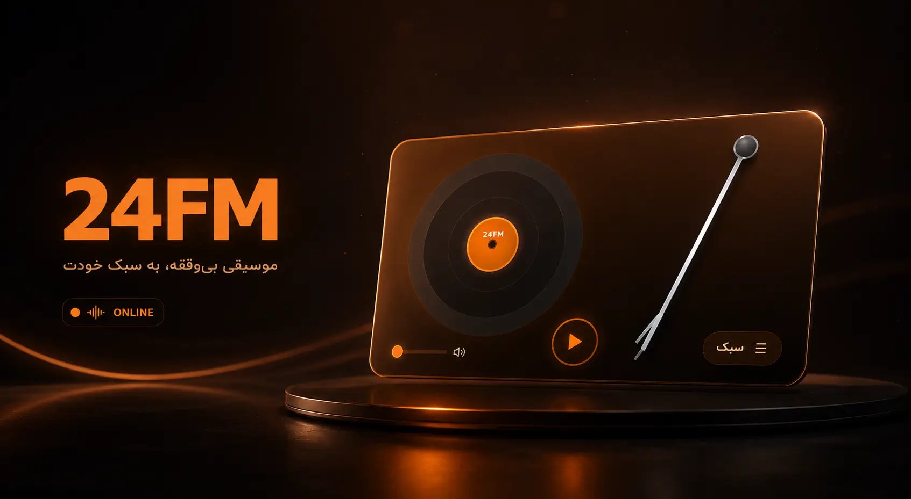

  
  # 📻 24FM | اف‌ام ۲۴
  **موسیقی بی‌وقفه، به سبک خودت — رادیو آنلاین ۲۴ ساعته**

  ## **[24FM.ir](https://24fm.ir)**

  

  
  
  
  

  

  

---

## 📻 تجربه 24FM

پروژه **24FM** یک رادیوی آنلاین ۲۴ ساعته و پریمیوم است که برای پخش بی‌نقص موسیقی در هر لحظه طراحی شده است. چه در حال رانندگی باشید، چه در مهمانی، زمان استراحت یا حتی وقتی که عمیقاً روی کار خود متمرکز هستید، 24FM تنها با یک کلیک فضای مناسب شما را فراهم می‌کند.

با خستگی ناشی از جستجو و پیدا کردن آهنگ‌های جدید خداحافظی کنید! ما یک رابط کاربری بسیار زیبا، نوستالژیک و در دسترس طراحی کرده‌ایم که برای تمام گروه‌های سنی جذاب است. فقط کافیست بنشینید، استراحت کنید و بگذارید موسیقی پخش شود.

---

## ✨ ویژگی‌های پریمیوم

- 🎧 **پخش‌کننده تعاملی گرامافون:** تجربه موسیقی با انیمیشن‌های روان و مینیمال شامل چرخش دیسک، جابه‌جایی بازوی گرامافون و افکت‌های خیره‌کننده Glassmorphism.
- 🚀 **فوق‌العاده سبک و بهینه:** مهندسی شده برای بالاترین بازدهی. 24FM روی ارزان‌ترین هاست‌های لینوکسی اشتراکی تا سرورهای مجازی (VPS) و اختصاصی قدرتمند، بدون هیچ فشاری روان و بی‌نقص اجرا می‌شود.
- 📡 **استریمینگ در سطح اینترپرایز:** یکپارچگی کامل با پروتکل‌های قدرتمند HLS (HTTP Live Streaming) برای تضمین یک استریم صوتی شفاف و بدون بافر.
- 🛡️ **مقاومت در برابر قطعی شبکه:** سیستم Watchdog داخلی و مکانیزم‌های هوشمند تلاش مجدد (Auto-retry) تضمین می‌کنند که حتی با نوسانات سرعت اینترنت، استریم قطع نشود.
- 🎭 **مدیریت هوشمند وضعیت (State):** مدیریت بی‌نقص وضعیت‌های `Play`، `Pause`، `Buffering` و تشخیص دقیق خطاهای شبکه.

---

## 🛠️ معماری پیشرفته (Tech Stack)

تکنولوژی‌های استفاده شده با دقت و ظرافت انتخاب شده‌اند تا یک تجربه پریمیوم، پایدار و با بالاترین کارایی را در تمام لایه‌ها ارائه دهند:

| Component | Technology | Architecture Detail |
| :--- | :--- | :--- |
| **User Interface (UI)** | `HTML5`, `CSS3` | Modern CSS variables, backdrop blurs, and hardware-accelerated keyframe animations for a premium dark mode aesthetic. |
| **Client Logic** | `Vanilla JavaScript` | Modular, dependency-free architecture (`player.js`, `app.js`, `popup.js`) for lightning-fast execution and zero bloat. |
| **Streaming Core** | `hls.js` | Advanced adaptive bitrate streaming, handling audio chunks and network buffering with precision. |
| **Backend API** | `PHP 8.x (Strict Types)` | High-performance, securely typed RESTful endpoints managing active sessions and telemetry. |
| **Storage Engine** | `File-based System` | Ultra-fast, zero-configuration `.jsonl` and `.sess` flat-file storage, eliminating SQL overhead and optimizing read/write speeds. |
| **Android App** | `Kotlin`, `Media3`, `WebView` | Native background playback through a `MediaSessionService`, a hardened WebView for the site, and separate Cafe Bazaar and Myket flavors. |

---

## 📱 اپلیکیشن اندروید

نسخهٔ اندروید 24FM (نسخهٔ **1.0.0**، شناسهٔ بسته `ir.fm24.app`) در پوشهٔ [`android/`](android/) قرار دارد. اپ همین سایت را در یک WebView امن نمایش می‌دهد، اما پخش صدا را به یک سرویس نیتیو می‌سپارد. به این ترتیب رادیو با خاموش شدن صفحه، روی صفحهٔ قفل و حتی بعد از بستن اپ ادامه پیدا می‌کند.

- 🎧 **پخش نیتیو در پس‌زمینه:** پخش با Media3/ExoPlayer، با اعلان رسانه و کنترل از صفحهٔ قفل، هدست و بلوتوث. تمرکز صدا (Audio Focus) و اتصال مجدد هم مدیریت می‌شوند و هیچ‌وقت دو صدا هم‌زمان پخش نمی‌شود.
- 💿 **صفحهٔ بارگذاری گرامافونی:** صفحهٔ گرامافون تا پایان کامل بارگذاری سایت می‌چرخد و بعد با یک حرکت نرم کنار می‌رود.
- 🗂️ **کش هوشمند:** پیش از هر بارگذاری، تغییرات سایت با درخواست‌های سبک HEAD بررسی می‌شود. اگر سایت تغییری نکرده باشد، نسخهٔ ذخیره‌شده فوراً باز می‌شود. اگر تغییر کرده باشد، کش پاک و نسخهٔ جدید جایگزین می‌شود. وقتی اینترنت قطع یا ضعیف است، آخرین نسخهٔ ذخیره‌شده نمایش داده می‌شود. کوکی‌ها و تنظیمات کاربر هرگز پاک نمی‌شوند.
- 💬 **پیام‌های خطای دوستانه:** پیام‌های کوتاه و آرام فارسی با دکمهٔ «تلاش دوباره»، و کد فنی خطا با نوشتهٔ کوچک.
- 🏪 **نسخهٔ جدا برای هر استور:** دو flavor با نام‌های `bazaar` (کافه‌بازار) و `myket` (مایکت)، با کد مشترک در یک جا و پوشهٔ اختصاصی برای هر استور.
- 📐 **سازگار با همهٔ صفحه‌ها:** از گوشی در حالت عمودی و افقی تا تبلت، تاشوها و تقسیم صفحه، با رعایت کامل لبه‌به‌لبه (Edge-to-Edge).

### تنظیمات SDK

| مورد | مقدار |
| --- | --- |
| minSdk | 24 (اندروید 7.0) |
| targetSdk | 37 (اندروید 17) |
| compileSdk | 37 |
| Android Gradle Plugin / Gradle / Kotlin | 9.5.1 / 9.9.1 / 2.4.21 |

مایکت از ۱ آبان ۱۴۰۵ انتشار برنامه یا به‌روزرسانی با Target SDK کمتر از ۳۴ را نمی‌پذیرد، و گوگل‌پلی هم از ۳۱ اوت ۲۰۲۶ حداقل سطح ۳۶ را الزامی کرده است. هدف‌گیری سطح ۳۷، یعنی آخرین نسخهٔ پایدار اندروید، هر دو استور را با فاصلهٔ کافی پوشش می‌دهد. راهنمای ساخت، امضا و جزئیات فنی در [`android/README.md`](android/README.md) آمده است.

---

## 🤝 دعوت به مشارکت

**پروژه 24FM با همکاری جامعه کاربری رشد می‌کند!** ما به قدرت متن‌باز (Open-source) باور داریم و از تمامی توسعه‌دهندگان، طراحان و علاقه‌مندان به موسیقی دعوت می‌کنیم تا در شکل‌گیری آینده این پلتفرم سهیم باشند.

فقط پروژه را کلون و بی‌صدا هاست نکنید، بخشی از هسته اصلی باشید! چه اضافه کردن تم‌های بصری جدید باشد، چه بهینه‌سازی موتور استریمینگ و چه رفع باگ‌ها، از Pull Request های شما به شدت استقبال می‌شود. بیایید با هم بهترین تجربه رادیوی آنلاین را بسازیم. 🌟

---

## 📜 لایسنس

این پروژه تحت لایسنس **GNU Affero General Public License v3.0 (AGPL v3)** منتشر شده است. 
این بدان معناست که شما آزادید تا این نرم‌افزار را استفاده، تغییر و توزیع کنید، اما هر نسخه تغییر یافته یا سرویسی که بر روی این کد اجرا می‌شود **باید** با همین لایسنس به صورت متن‌باز منتشر شود. این موضوع تضمین می‌کند که 24FM برای همیشه آزاد و در دسترس همگان باقی بماند.

---

## 👨‍💻 توسعه‌دهندگان

- 🗽 [**AmirhosseinBrooklyn**](https://github.com/AmirhosseinBrooklyn)
- 🧑🏻‍💻 [**HTTPS-CMD**](https://github.com/HTTPS-CMD)

[ 🐛 [Found a bug? Let us know!](https://github.com/AmirhosseinBrooklyn/24FM/issues/new) ]

